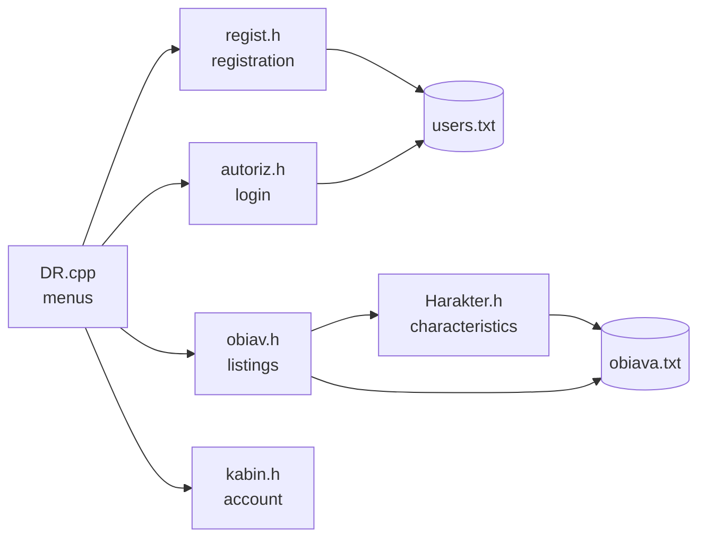

# Drom

**English** | [Русский](README.ru.md)

**A console car-classifieds app in C++ — a college project, kept as a working
example of a multi-module program with no frameworks, no database and no
external dependencies.**

[](https://isocpp.org/)
[-5C2D91)](https://visualstudio.microsoft.com/)
[](LICENSE)

Drom simulates the core of a car marketplace in a terminal: a user registers,
logs in, browses a list of cars, opens a listing to see its price, mileage and
the seller's rating, and can look at their own account. Everything is stored in
two plain-text files next to the executable — there is no server and nothing to
install.

It was written in my second year of college as an exercise in splitting a
program into modules: each screen lives in its own header, and the entry point
only wires them together.

## What it does

```text
1. (Регистрация)
2. (Авторизация)
3. (Выход из приложения)
```

- **Registration** checks that the login is not taken yet and appends the pair
  to `users.txt`.
- **Authorization** reads `users.txt` line by line and returns the matching
  record, which is then used by the account screen.
- **Listings** prints the brands from `obiava.txt`; picking a number opens the
  car's characteristics.
- **Personal account** shows the login and password of the current user.
- **Log out** returns to the authorization screen.

## Modules

| File | Responsibility |
| --- | --- |
| `DR/DR.cpp` | Entry point, console code page, registration/authorization menu, main menu |
| `DR/regist.h` | Login uniqueness check, writing a new user to `users.txt` |
| `DR/autoriz.h` | Reading `users.txt`, matching login and password |
| `DR/obiav.h` | Listing brands from `obiava.txt`, selecting one by number |
| `DR/Harakter.h` | Parsing one listing line and printing its characteristics |
| `DR/kabin.h` | Personal account screen |



## Data files

`users.txt` — one user per line, login and password separated by a space:

```text
Максим 1234
Егор 54321
```

`obiava.txt` — one car per line, five fields separated by `;`:

```text
N)Марка;цена;пробег;рейтинг продавца;коробка передач
```

Real content from the project:

```text
1)Седан;1004000;60000км;4.5;автомат
2)ВАЗ 2106;124500;120000000км;1.6;механика
```

The `N)` prefix is the line number and is dropped when the record is displayed.
Both files are read from the current working directory, which is the project
folder when the app is started from Visual Studio.

## Build and run

1. Open `DR.sln` in Visual Studio 2019 (or newer; the platform toolset is
   `v142`).
2. Select `x64` and press <kbd>Ctrl</kbd>+<kbd>F5</kbd>.

From the command line:

```bat
msbuild DR.sln /p:Configuration=Debug /p:Platform=x64
DR\x64\Debug\DR.exe
```

The console is switched to UTF-8 (`65001`) and the project is compiled with
`/utf-8`, so the Russian text works on Windows 10 and later. The sources were
originally saved in Windows-1251; they were converted to UTF-8 so that GitHub
shows them correctly.

