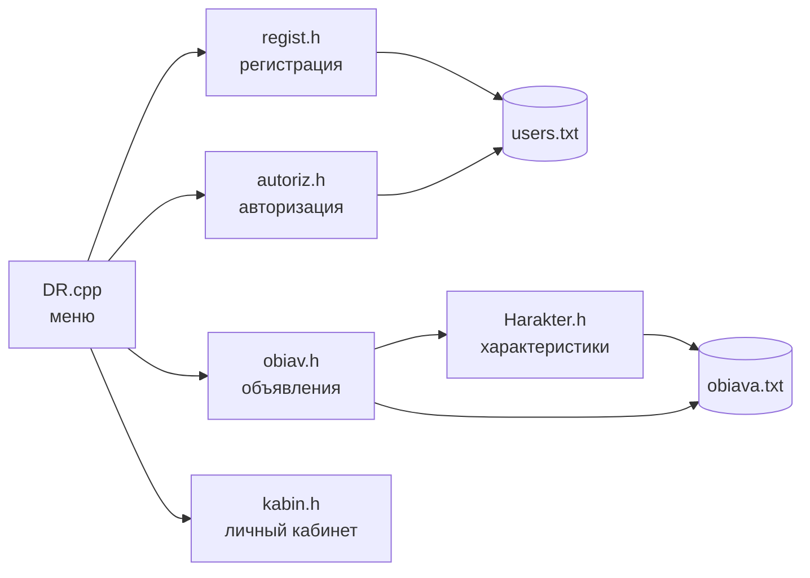

# Drom

[English](README.md) | **Русский**

**Консольное приложение-автомобильная доска объявлений на C++ — проект,
сделанный в колледже: многомодульная программа без фреймворков, базы данных и
внешних зависимостей.**

[](https://isocpp.org/)
[-5C2D91)](https://visualstudio.microsoft.com/)
[](LICENSE)

Drom имитирует основу сайта объявлений о продаже машин прямо в терминале:
пользователь регистрируется, входит в аккаунт, смотрит список автомобилей,
открывает объявление и видит цену, пробег и рейтинг продавца, а также может
заглянуть в личный кабинет. Всё хранится в двух текстовых файлах рядом с
программой — ни сервера, ни установки.

Проект написан на втором курсе колледжа как упражнение в разделении программы
на модули: каждый экран — отдельный заголовочный файл, а точка входа только
связывает их между собой.

## Что умеет

```text
1. (Регистрация)
2. (Авторизация)
3. (Выход из приложения)
```

- **Регистрация** проверяет, что логин ещё не занят, и дописывает пару в
  `users.txt`.
- **Авторизация** построчно читает `users.txt` и возвращает подходящую запись,
  которую затем использует экран личного кабинета.
- **Объявления** выводят марки из `obiava.txt`; по номеру открываются
  характеристики выбранной машины.
- **Личный кабинет** показывает логин и пароль текущего пользователя.
- **Выход из аккаунта** возвращает на экран авторизации.

## Модули

| Файл | Ответственность |
| --- | --- |
| `DR/DR.cpp` | Точка входа, кодовая страница консоли, меню регистрации/авторизации, главное меню |
| `DR/regist.h` | Проверка уникальности логина, запись нового пользователя в `users.txt` |
| `DR/autoriz.h` | Чтение `users.txt`, сверка логина и пароля |
| `DR/obiav.h` | Вывод марок из `obiava.txt`, выбор объявления по номеру |
| `DR/Harakter.h` | Разбор строки объявления и печать характеристик |
| `DR/kabin.h` | Экран личного кабинета |



## Файлы данных

`users.txt` — по одному пользователю в строке, логин и пароль через пробел:

```text
Максим 1234
Егор 54321
```

`obiava.txt` — по одной машине в строке, пять полей через `;`:

```text
N)Марка;цена;пробег;рейтинг продавца;коробка передач
```

Реальное содержимое проекта:

```text
1)Седан;1004000;60000км;4.5;автомат
2)ВАЗ 2106;124500;120000000км;1.6;механика
```

Префикс `N)` — номер строки, при выводе он отбрасывается. Оба файла читаются из
текущей рабочей папки; при запуске из Visual Studio это папка проекта.

## Сборка и запуск

1. Откройте `DR.sln` в Visual Studio 2019 (или новее; набор инструментов —
   `v142`).
2. Выберите `x64` и нажмите <kbd>Ctrl</kbd>+<kbd>F5</kbd>.

Из командной строки:

```bat
msbuild DR.sln /p:Configuration=Debug /p:Platform=x64
DR\x64\Debug\DR.exe
```

Консоль переключается в UTF-8 (`65001`), проект компилируется с `/utf-8`,
поэтому русский текст корректно работает на Windows 10 и новее. Изначально
исходники были в Windows-1251; они переведены в UTF-8, чтобы GitHub показывал
их без мусора.

## Про `Harakter.h`

В копии проекта, которая сохранилась на флешке, файл `Harakter.h` оказался
повреждён — это уже не был текст. Он восстановлен по документации проекта
(описание экрана «Характеристики») и совпадает с форматом данных и выводом
исходного собранного `DR.exe`.

## Что я сделал бы сегодня иначе

Это студенческий код, и это видно. Он оставлен как есть намеренно — переписывать
его в «идеальный» проект означало бы потерять смысл работы, — но слабые места
стоит назвать:

- **Пароли хранятся в открытом виде.** Сегодня — соль и хеш, никогда сам пароль.
- **Строки разбираются подсчётом разделителей.** Пропущенная `;` сдвигает все
  поля. Сегодня — небольшой парсер с валидацией и понятными ошибками.
- **Личный кабинет показывает пароль обратно пользователю.** Сегодня — никогда.
- **Логика живёт в заголовочных файлах.** Для курсовой из шести файлов это
  нормально, для чего-то большего — нет: пары `.h` + `.cpp` и пространство имён.
- **Нет тестов.** Функции разбора чистые, их легко покрыть юнит-тестами.
- **Файлы перечитываются на каждом экране.** Маленький класс-репозиторий убрал бы
  дублирование между `autoriz.h`, `regist.h`, `obiav.h` и `kabin.h`.

## Лицензия

MIT — см. [LICENSE](LICENSE).
